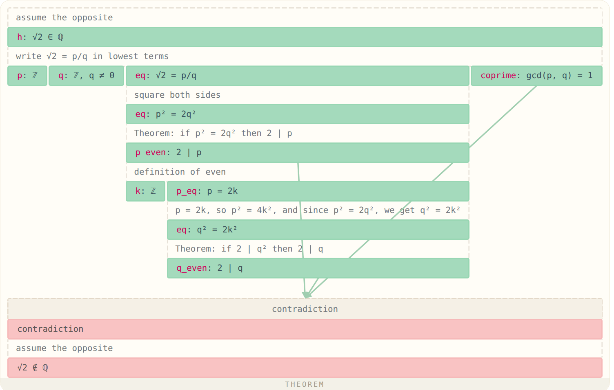

# paperproof

Show a proof as a [Paperproof](https://paperproof.xyz) tree on your own web page: goals, hypotheses, and arrows showing which step uses what.



## Putting a proof on a page

```html
<script src="https://cdn.jsdelivr.net/npm/paperproof@0.1.0/dist/paperproof-embed.js"></script>

<paperproof-proof>
  <script type="application/json">
    { the proof, as JSON }
  </script>
</paperproof-proof>
```

## Where the JSON comes from

- **A Lean proof:** in the [Paperproof VS Code extension](https://marketplace.visualstudio.com/items?itemName=paperproof.paperproof), right-click the proof and choose *Copy for LLM*.
- **An AI agent:** tell it to run `npx paperproof instructions`, which explains the format and how to check its work.

## Changing how it looks

| | |
|---|---|
| `theme="cyan"` | how a step that finishes a goal looks: `sand` (default), `cyan`, `check`, `square`, `check-goal`, `slate`, `clay` |
| `dark-bars` | darker HYPOTHESES and THEOREM bars |
| `unlimited-width` | long formulas stay on one line instead of wrapping |
| `fit="none"` | a tree wider than the page stays full size and the page scrolls, instead of the tree shrinking to fit |

Readers can also right-click a tree to try the themes; their browser remembers the choice.
